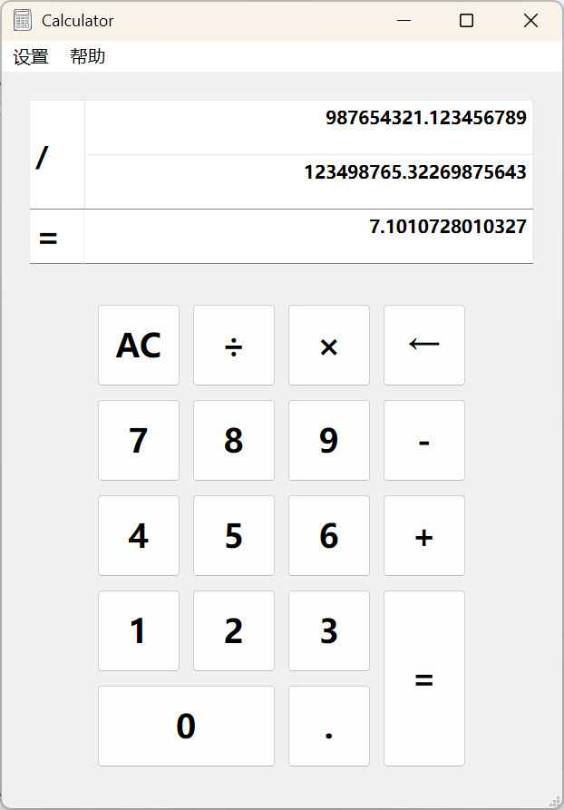

# Qt High-Precision Calculator

[中文](README_CN.md)

## Project Introduction
This is a **high-precision** calculator application developed based on the Qt framework, supporting basic arithmetic operations (addition, subtraction, multiplication, division), and providing configurable decimal places settings. The calculator uses a custom high-precision numeric class to achieve accurate calculations, **avoiding precision error issues in floating-point calculations**.

<div align=center></div>

## Features

### Basic Calculation Features
- Support for four arithmetic operations: addition (+), subtraction (-), multiplication (*), division (/)
- Support for decimal point input
- Support for negative number operations
- Support for continuous calculations
- High-precision calculation to avoid floating-point precision errors

### User Interface Features
- Intuitive graphical user interface
- Clear calculation process display
- Keyboard shortcut support
- Right-click menu operation
- Status bar information prompts

### Configuration Features
- Customizable decimal places for calculation results
- Support for reset and clear operations

### Help Features
- Provide operation guide dialog box
- Include software information dialog box

## Technology Stack
- C++
- Qt Framework (Qt Widgets)
- Custom data structure for high-precision calculation

## Project Structure

```
calculator/
├── calculator.pro       # Qt project configuration file
├── calculator.pro.user  # User project configuration
├── main.cpp             # Program entry file
├── mainwindow.cpp       # Main window implementation
├── mainwindow.h         # Main window header file
├── mainwindow.ui        # Main window UI design
├── node.cpp             # Linked list node implementation
├── node.h               # Linked list node header file
├── number.cpp           # High-precision numeric class implementation
├── number.h             # High-precision numeric class header file
├── tempnum.cpp          # Temporary data management implementation
├── tempnum.h            # Temporary data management header file
├── dialog_setbit.cpp    # Decimal places setting dialog implementation
├── dialog_setbit.h      # Decimal places setting dialog header file
├── dialog_setbit.ui     # Decimal places setting dialog UI design
├── dialog_help.cpp      # About dialog implementation
├── dialog_help.h        # About dialog header file
├── dialog_help.ui       # About dialog UI design
├── dialog_tip.cpp       # Help tip dialog implementation
├── dialog_tip.h         # Help tip dialog header file
├── dialog_tip.ui        # Help tip dialog UI design
└── res/                 # Resource folder
    ├── ICON.jpg         # Application icon
    └── res.qrc          # Resource configuration file
```

## Core Class Description

### MainWindow Class
Main window class responsible for handling user interface interaction and calculation logic scheduling.
- Manage button click events and keyboard shortcuts
- Coordinate numeric input and calculation operations
- Display calculation process and results
- Manage dialog boxes and menu operations

### Number Class
High-precision numeric class that uses a doubly linked list to implement high-precision numeric storage and calculation.
- Support for arithmetic operation operator overloading
- Provide input/output functionality for high-precision numbers
- Automatically handle carry and decimal places
- Support for custom decimal places

### Node Class
Linked list node class that forms the basic data unit of the Number class.
- Store single digit
- Support node insertion and traversal
- Maintain references to previous and next nodes

### TempNum Class
Temporary data management class that saves intermediate data during calculation.
- Store input numeric string
- Track calculation mode and status
- Manage operands and operators

## Installation and Usage

### Prerequisites
- Qt development environment (Qt 5.x or Qt 6.x recommended)
- C++ compiler (supporting C++17 standard)

### Compilation and Execution
1. Open the project file `calculator.pro` with Qt Creator
2. Build the project (Ctrl+B)
3. Run the program (Ctrl+R)

### Usage Instructions
1. **Basic Calculation**: Click on the number buttons to input values, click on the operator buttons to select the operation type, and click on the equals button to get the result
2. **Decimal Places Setting**: Select "Modify Calculation Precision" from the menu bar, and enter the desired number of decimal places in the pop-up dialog box
3. **Keyboard Shortcuts**: 
   - Numeric keys 0-9: Input corresponding numbers
   - Operator keys +, -, *, /: Select corresponding operations
   - Enter key: Calculate results
   - Backspace key: Delete the last input character
   - Delete key: Clear current input or all data
4. **Help Functions**: View operation guides and about information through the menu bar

## High-Precision Calculation Principle

This calculator uses a doubly linked list to implement high-precision calculations, with each node storing a single digit. This design avoids precision issues in floating-point calculations and is particularly suitable for financial or scientific calculation scenarios that require precise results.

The core steps of high-precision calculation:
1. Convert the input numeric string to a linked list storage structure
2. Implement four arithmetic operations according to mathematical operation rules
3. Handle carry, borrow, and decimal point positions
4. Format the output result according to the set number of decimal places

## Notes
1. In division operations, results will be rounded according to the set number of decimal places
2. During continuous calculations, the result of the previous calculation will automatically become the first operand of the next calculation
3. To input a negative number, directly press the minus key in an empty input state
4. When the number of decimal places is set to 0, all calculation results will be rounded to integers

## Development Instructions

### Code Standards
- Follow Qt's naming conventions and coding style
- Class names use camel case (capitalized first letter)
- Member functions and variables use camel case (lowercase first letter)
- Constants use all uppercase letters with underscores

### Extension Suggestions
1. Add scientific calculation functions (trigonometric functions, logarithms, etc.)
2. Implement history record function
3. Add theme switching function
4. Support complex number operations
5. Add unit conversion function

## Update Log

### Version 1.0
- Initial version
- Implement basic four arithmetic operations
- Support high-precision calculation
- Provide decimal places setting function
- Include help and about dialog boxes

## License

MIT License

## Acknowledgements

Thank you to the Qt framework for providing powerful GUI development capabilities, and to all developers who have helped with this project.