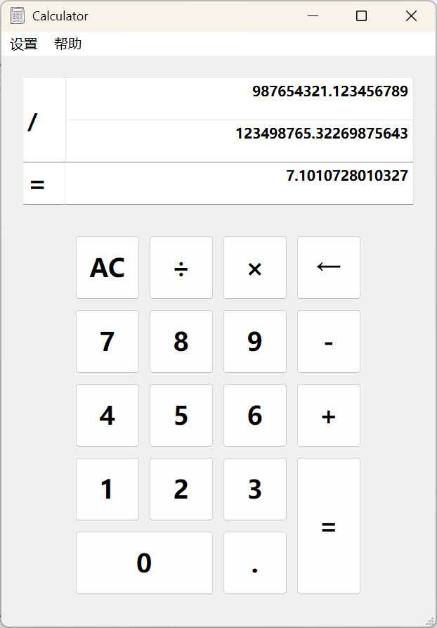

# Qt高精度计算器

[English](README.md)

## 项目简介
这是一个基于Qt框架开发的**高精度**计算器应用程序，支持基本的四则运算（加、减、乘、除），并提供可配置的小数位数设置功能。该计算器使用自定义的高精度数值类实现精确计算，**避免了浮点数计算中的精度误差问题**。

<div align=center></div>

## 功能特性

### 基本计算功能
- 支持加（+）、减（-）、乘（*）、除（/）四则运算
- 支持小数点输入
- 支持负数运算
- 支持连续计算
- 高精度计算，避免浮点数精度误差

### 用户界面功能
- 直观的图形用户界面
- 清晰的计算过程显示
- 键盘快捷键支持
- 右键菜单操作
- 状态栏信息提示

### 配置功能
- 可自定义设置计算结果的小数位数
- 支持重置和清除操作

### 帮助功能
- 提供操作指南对话框
- 包含关于软件的信息对话框

## 技术栈
- C++
- Qt框架（Qt Widgets）
- 自定义数据结构实现高精度计算

## 项目结构

```
calculator/
├── calculator.pro       # Qt项目配置文件
├── calculator.pro.user  # 用户项目配置
├── main.cpp             # 程序入口文件
├── mainwindow.cpp       # 主窗口实现
├── mainwindow.h         # 主窗口头文件
├── mainwindow.ui        # 主窗口UI设计
├── node.cpp             # 链表节点实现
├── node.h               # 链表节点头文件
├── number.cpp           # 高精度数值类实现
├── number.h             # 高精度数值类头文件
├── tempnum.cpp          # 临时数据管理实现
├── tempnum.h            # 临时数据管理头文件
├── dialog_setbit.cpp    # 小数位数设置对话框实现
├── dialog_setbit.h      # 小数位数设置对话框头文件
├── dialog_setbit.ui     # 小数位数设置对话框UI设计
├── dialog_help.cpp      # 关于对话框实现
├── dialog_help.h        # 关于对话框头文件
├── dialog_help.ui       # 关于对话框UI设计
├── dialog_tip.cpp       # 帮助提示对话框实现
├── dialog_tip.h         # 帮助提示对话框头文件
├── dialog_tip.ui        # 帮助提示对话框UI设计
└── res/                 # 资源文件夹
    ├── ICON.jpg         # 应用程序图标
    └── res.qrc          # 资源配置文件
```

## 核心类说明

### MainWindow 类
主窗口类，负责处理用户界面交互和计算逻辑调度。
- 管理按钮点击事件和键盘快捷键
- 协调数值输入和计算操作
- 显示计算过程和结果
- 管理对话框和菜单操作

### Number 类
高精度数值类，使用双向链表实现高精度数值的存储和计算。
- 支持四则运算操作符重载
- 提供高精度数值的输入输出功能
- 自动处理进位和小数位
- 支持自定义小数位数

### Node 类
链表节点类，构成Number类的基本数据单元。
- 存储单个数字位
- 支持节点的插入和遍历
- 维护前后节点的引用

### TempNum 类
临时数据管理类，保存计算过程中的中间数据。
- 存储输入的数值字符串
- 跟踪计算模式和状态
- 管理操作数和运算符

## 安装和使用

### 前提条件
- Qt开发环境（推荐Qt 5.x或Qt 6.x）
- C++编译器（支持C++17标准）

### 编译和运行
1. 使用Qt Creator打开项目文件 `calculator.pro`
2. 构建项目（Ctrl+B）
3. 运行程序（Ctrl+R）

### 使用说明
1. **基本计算**：点击数字按钮输入数值，点击运算符按钮选择运算类型，点击等号按钮获取结果
2. **小数位数设置**：通过菜单栏选择"修改计算精度"，在弹出的对话框中输入所需的小数位数
3. **快捷键支持**：
   - 数字键 0-9：输入对应数字
   - 运算符键 +, -, *, /：选择对应运算
   - Enter键：计算结果
   - Backspace键：删除最后一个输入字符
   - Delete键：清除当前输入或所有数据
4. **帮助功能**：通过菜单栏查看操作指南和关于信息

## 高精度计算原理

该计算器使用双向链表实现高精度计算，每个节点存储一个数字位。这种设计避免了浮点数计算中的精度问题，特别适用于需要精确结果的金融计算或科学计算场景。

高精度计算的核心步骤：
1. 将输入的数字字符串转换为链表存储结构
2. 按照数学运算规则实现四则运算
3. 处理进位、借位和小数点位置
4. 根据设置的小数位数格式化输出结果

## 注意事项
1. 除法运算中，结果会根据设置的小数位数进行四舍五入
2. 连续计算时，前一次计算的结果会自动作为下一次计算的第一个操作数
3. 输入负数时，直接在空输入状态下按减号键
4. 当小数位数设置为0时，所有计算结果都将取整

## 开发说明

### 代码规范
- 遵循Qt的命名规范和编码风格
- 类名使用驼峰命名法（首字母大写）
- 成员函数和变量使用驼峰命名法（首字母小写）
- 常量使用全大写字母加下划线

### 扩展建议
1. 增加科学计算功能（三角函数、对数等）
2. 实现历史记录功能
3. 添加主题切换功能
4. 支持复数运算
5. 增加单位换算功能

## 更新日志

### 版本 1.0
- 初始版本
- 实现基本的四则运算
- 支持高精度计算
- 提供小数位数设置功能
- 包含帮助和关于对话框

## License

MIT License

## 致谢

感谢Qt框架提供的强大GUI开发能力，以及所有对本项目提供帮助的开发者。